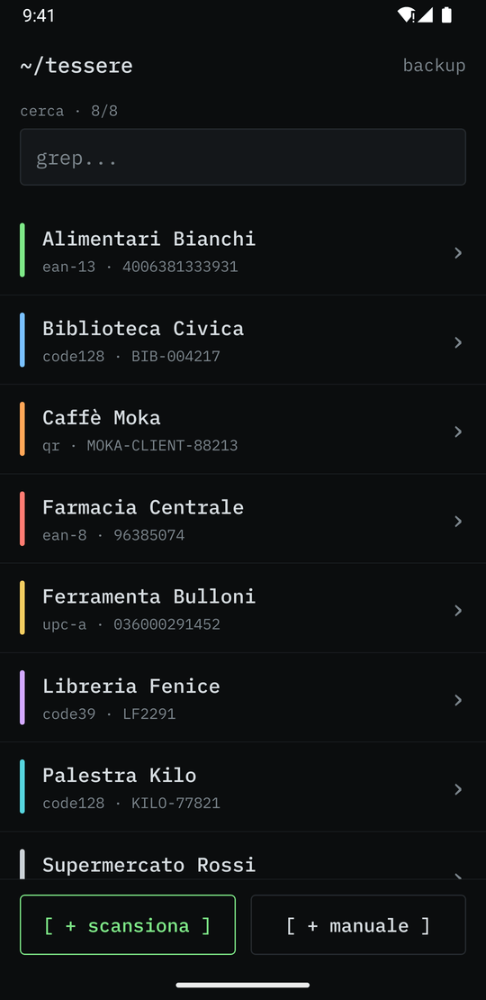
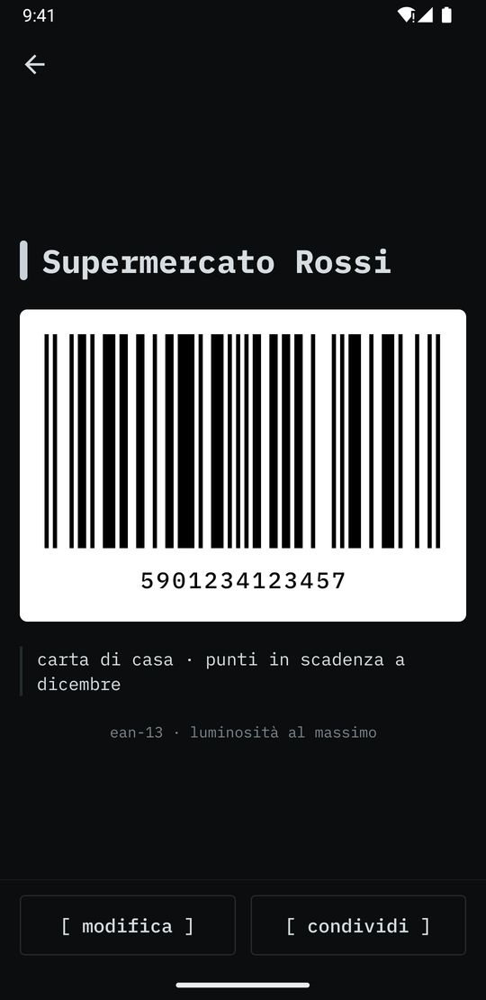
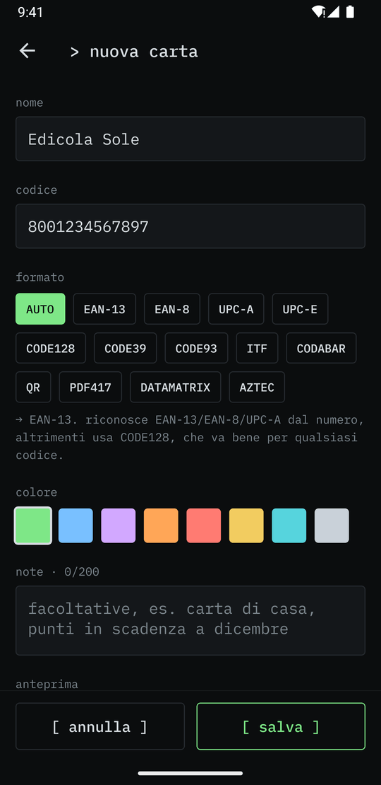
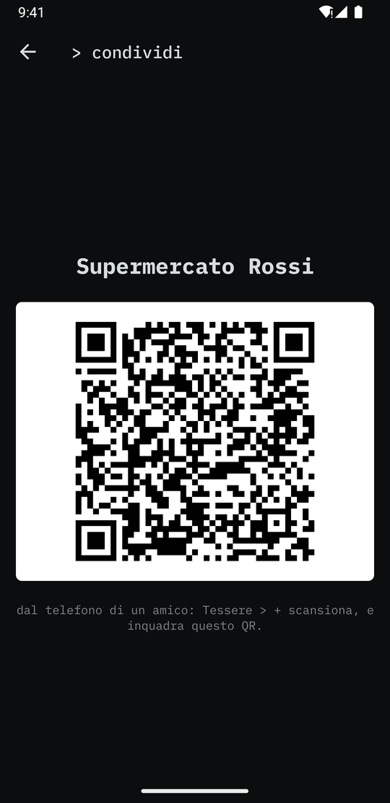

# tessere

Portafoglio di carte fedeltà per Android. Scansioni il codice della carta una volta, poi in cassa mostri lo schermo.
Tutto resta sul telefono: nessun account, nessun server.

<p>
  
  
  
  
</p>

<sub>Le carte negli screenshot sono inventate.</sub>

## Funzioni

- **Scansione** dalla fotocamera (EAN-13/8, UPC-A/E, Code128/39/93, ITF, Codabar, QR, PDF417, DataMatrix, Aztec)
- **Scansione da immagine**: _+ scansiona → da immagine_ legge il codice da uno screenshot o da una foto, scelti con il Photo Picker di sistema (nessun permesso di accesso ai file). Se il codice non viene trovato, propone di ritagliare l'immagine e riprovare
- **Inserimento manuale** per le carte con solo il numero stampato, con anteprima e validazione del codice in tempo reale. Il formato è su AUTO di default: EAN-13, EAN-8 e UPC-A vengono riconosciuti dalla cifra di controllo, tutto il resto diventa CODE128
- **Suggerimenti di nome e colore**: mentre scrivi il nome, propone le catene più diffuse (Esselunga, Coop, Conad, Carrefour, Lidl, IKEA…) da un catalogo offline. Toccandone una si impostano nome e colore del marchio. Il catalogo è in `src/lib/chains.ts`
- **Note** facoltative su ogni carta (max 200 caratteri)
- **Lista** in ordine alfabetico con ricerca per nome, numero o note
- **Visualizzazione**: luminosità al massimo e schermo sempre acceso finché la carta è aperta
- **Condivisione via QR**: _carta → condividi_ mostra un QR. Un amico lo inquadra con _+ scansiona_ e la carta viene importata. Le note non vengono condivise
- **Backup JSON**: _backup → esporta/importa_, note comprese. All'import, le carte già presenti (stesso codice e formato) vengono saltate

## Sviluppo

```bash
npm install
npx expo run:android    # build di sviluppo su dispositivo/emulatore collegato
npx tsc --noEmit && npx expo lint
```

La cartella `android/` è generata da `expo prebuild` e non va modificata a mano: la configurazione nativa sta in `app.json`.

## APK

```bash
npm run apk
# → android/app/build/outputs/apk/release/tessere-app-release.apk
```

### Firma

L'APK di release è firmato con un keystore personale che non è nel repo. Il config plugin `plugins/withReleaseSigning.js`
lo legge da `~/.gradle/gradle.properties`:

```properties
TESSERE_KEYSTORE_FILE=/percorso/assoluto/tessere-release.jks
TESSERE_KEYSTORE_PASSWORD=...
TESSERE_KEY_ALIAS=tessere
TESSERE_KEY_PASSWORD=...
```

Senza queste proprietà la release viene firmata con il keystore di debug (Gradle lo segnala con un avviso):
il progetto compila, ma l'APK non si installa sopra quello ufficiale.

Il keystore e le password vanno conservati in un posto sicuro: senza di loro non si possono più pubblicare
aggiornamenti installabili sopra la versione esistente.

A ogni nuova versione incrementa `version` e `android.versionCode` in `app.json`.

L'APK è compilato solo per `arm64-v8a` e **senza minificazione R8** (`expo-build-properties` in `app.json`). Non riattivarla:
ML Kit, la libreria di scansione, crea i suoi componenti per riflessione e R8 ne rimuove i costruttori. La camera si apre ma
non legge nessun codice, e nei log compare `Failed to initialize BarcodeAnalyzer`.

`.npmrc` contiene `legacy-peer-deps=true` per evitare un conflitto con `react-dom`, una peer dependency opzionale di expo-router usata solo per il web.

## Struttura

```
src/app/            schermate (expo-router)
  index.tsx         lista + ricerca
  scan.tsx          fotocamera
  edit.tsx          nuova carta / modifica
  card/[id].tsx     carta da mostrare in cassa
  share/[id].tsx    QR di condivisione
  backup.tsx        export / import JSON
src/lib/            dati (cards), codici (barcode, bwip-js), transfer, tema
src/components/     BarcodeView, componenti UI
```

I dati sono in `tessere.json`, nella cartella documenti dell'app.
